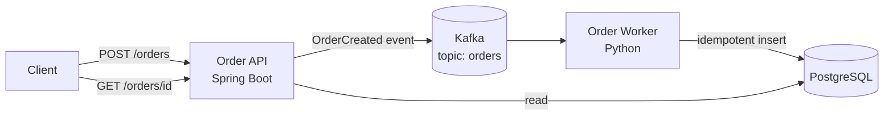

# SecureShip

An order-processing system built as a **DevSecOps reference project**: a small, realistic app shipped through a pipeline that builds, tests, scans, deploys, and monitors it automatically.

> **Status:** Week 1 of 4 – application and tests complete. Security gates, Kubernetes deployment, and observability are being added week by week (see [Roadmap](#roadmap)).

## Architecture



1. The **API** validates an order and publishes an event to Kafka, returning `202 Accepted`.
2. The **worker** consumes the event, validates it again, calculates the total, and stores it.
3. `GET /orders/{id}` returns the stored order.

## Run it locally

Requires Docker Desktop.

```bash
cp .env.example .env          # then set a local-only password in .env
docker compose up --build -d
```

Create an order and fetch it:

```bash
curl -s -X POST localhost:8080/orders \
  -H "Content-Type: application/json" \
  -d '{"customerId":"cust-42","item":"Margherita pizza","quantity":2,"unitPrice":12.50}'
# -> {"orderId":"<id>","status":"PENDING"}

curl -s localhost:8080/orders/<id>
# -> {"orderId":"<id>",...,"totalPrice":25.00,"status":"PROCESSED",...}

curl -s localhost:8080/actuator/health
```

Stop everything with `docker compose down` (add `-v` to also delete the database volume).

## Run the tests

```bash
# API (needs JDK 17 + Maven) - or run inside Docker with no local install:
docker run --rm -v "$PWD/api":/src -w /src maven:3.9-eclipse-temurin-17 mvn -B test

# Worker
cd worker && pip install -r requirements-dev.txt && pytest -v
```

## Security built in from week 1

| Control | Where |
| --- | --- |
| Input validated at the API **and** again in the worker (defence in depth) | `OrderRequest.java`, `processing.py` |
| Database constraints mirror the validation rules | `db/init.sql` |
| Parameterised SQL only – no string-built queries (SQL injection) | `OrderRepository.java`, `processing.py` + a test |
| No secrets in code; the password comes from a git-ignored `.env` and compose refuses to start without it | `docker-compose.yml`, `.gitignore` |
| Containers run as non-root, from small runtime images | both `Dockerfile`s |
| Ports bound to `127.0.0.1` only | `docker-compose.yml` |
| Actuator exposes only `health` and `info`; no stack traces in error responses | `application.yml` |
| CI runs with read-only repository permissions | `.github/workflows/ci.yml` |

## Reliability and correctness choices

- **Money is exact:** `BigDecimal` in Java, `Decimal` in Python, never floating point. A test proves `3 × 0.10 = 0.30` exactly.
- **No lost or duplicate orders:** the worker commits the Kafka offset only after the database commit succeeds (at-least-once delivery), and the insert uses `ON CONFLICT DO NOTHING`, so a redelivered event is harmless.
- **Bad events don't crash the worker:** invalid messages are logged and skipped; database errors stop processing so the message is retried.
- **Timestamps always carry a timezone.**

## Roadmap

- [x] **Week 1 – App:** Spring Boot API, Kafka, Python worker, Postgres, Docker Compose, unit tests, basic CI
- [ ] **Week 2 – Security gates:** Semgrep (SAST), Syft + Grype (SBOM + SCA), Trivy (container scan), Checkov (IaC scan); high-severity findings fail the build
- [ ] **Week 3 – Deploy & test:** Terraform, Kubernetes (kind / EKS), Playwright API/E2E tests, OWASP ZAP (DAST), k6 load test
- [ ] **Week 4 – Observe:** Prometheus, Grafana, OpenTelemetry; write-up

Next improvements noted along the way: a dead-letter topic for rejected events, and confirming Kafka delivery before returning `202` (or an outbox pattern).

## Tech stack

Java 17 · Spring Boot 3.3 · Apache Kafka 3.8 · Python 3.12 · PostgreSQL 16 · Docker Compose · GitHub Actions

## What I learned

_(Write this yourself after each week – what broke, how you fixed it, what you'd do differently. Interviewers read this section.)_
